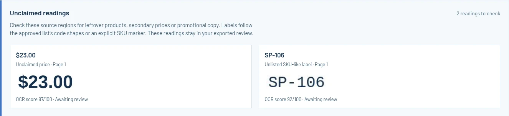

# Release checks

October 12, 2026. Chromium 154, with desktop and 390 px viewports.

The public GitHub Pages deployment also completed this flow in a fresh anonymous browser context: real PDF OCR, price-region rereading, seven scripted decisions and the exported review. The page returned HTTP 200; page errors and failed requests both remained at zero. The [workflow video](https://blucca.github.io/shelfproof/demo/) uses that recording.

## A complete proof

The [fictional Sunday Shelf artwork](sample-proof.md) is an image-only PDF. The real Tesseract LSTM model reads the rendered pixels in the browser. Six visible SKU labels and six prices were read correctly; the approved list has seven SKUs.

| SKU | Approved | Printed | Initial review state |
| --- | --- | --- | --- |
| SP-101 | $8.50 | $12.00 | Confirm pairing: SKU OCR score about 40/100 |
| SP-102 | $12.00 | $8.50 | Price differs |
| SP-103 | $14.50 | $14.50 | Price matches |
| SP-104 | $18.00 | $18.00 | Price matches |
| SP-105 | $6.75 | $6.75 | Price matches |
| SP-106 | $32.00 | $23.00 | Price differs |
| SP-107 | $4.25 | Absent | Locate SKU |

The two swapped prices both occur in the approved list. Matching each price to its own SKU exposes the swap. The low-scoring SP-101 reading keeps its source regions visible and asks the reviewer to check the association.

The browser check selected and reread a price region, confirmed the six visible readings, and marked SP-107 missing. The final summary contained three price differences, three matching readings, and one missing SKU. The exported HTML held all seven decisions and twelve embedded source crops, about 264 KB. Opening the review requires a browser; its crops travel with the file.

These decisions were performed by the development script. Customer artwork and independent studio feedback are the next validation step.

## A second layout

A separate fictional PNG used pounds, three SKUs, and a competing second price on one row. It produced one match, one request to confirm the pairing, and one price difference. This check exposed a distance cutoff that hid the competing price; the shared pairing rule now considers that same-row candidate and sends the ambiguous row for review.

Replacing the price list with an invalid CSV preserved the existing proof. Its subsequent export retained the original filenames and pound currency.

## Reproduce

```sh
npm test
python -m http.server 8138 --directory web
```

Open the app and select **Try the sample proof**. Inspect the SKU and price crops, confirm the readings, mark the final item missing, and choose **Download review**.

`tests/browser-smoke.py` automates that flow against an existing CDP browser. Its output directory belongs outside the source tree. The seven focused Node checks cover CSV input, integer money values, identifier matching, spatial pairing, competing prices, and review decisions. The release check also exercises the narrow mobile layout and reports page errors.

The first-release workflow accepts one currency, visible SKU labels and up to five artwork pages / fifty approved SKUs. Multi-price layouts use explicit region selection. Artwork and readings live in the browser tab; the downloaded review preserves the decisions.

## Reader-reported extra readings

October 14, 2026 (UTC). [pm25coder’s review](https://dev.to/pm25coder/comment/3hig5) supplied three concrete cases: an extra `SP-999` label, a distant `$99.00`, and an extra product/price close enough to make an approved SKU’s pairing ambiguous. `npm test` now covers all three, plus split labels, manual reselection and page-scoped region ownership. The original approved-SKU comparison API stays intact.

For a real OCR reproduction:

1. Download the [fictional artwork](../web/assets/sample-promo.pdf) and [approved CSV](../web/assets/sample-prices.csv).
2. Remove the `SP-106,Task Light,32.00` row from the CSV. Keep the artwork unchanged.
3. In ShelfProof, choose **Use my files** and read that PDF with the reduced CSV.
4. The extra-reading strip shows `$6.75`, `$23.00` and `SP-106`. Select SP-105, choose its `$6.75` region, and confirm that reading.
5. `SP-106` and `$23.00` remain in the strip and the downloaded review, each with its own source crop and page. The copied issue list includes both readings too.

The Chromium check performed those steps with the bundled Tesseract model. It exported six approved-SKU rows, two extra-reading records and twelve source crops. The 390 px layout had zero horizontal overflow; page errors were zero. All review actions were scripted on the fictional artwork.



Label detection follows the catalogue’s letter/digit/separator shape, or an explicit SKU marker, within six adjacent OCR words. Numeric IDs retain their digit count. A region containing several price candidates keeps those readings in the extra check; a single selected price clears its own region. The full proof remains available for checking other text and OCR omissions.
